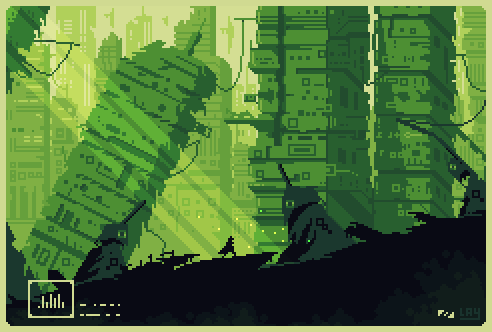

Artwork by [Kellay](https://bsky.app/profile/awfukellay.bsky.social), one of the artists for v1.2's splash screen artworks.

Remember, remember the... 3rd of November? Today may not be as memorable of a day as November the 5th, but the new Pixelorama version, v1.2.4, is definitely going to remain in your memory. Why? Because we finally implemented a very important feature, the ability to **keep content outside of the canvas**. That's right, no longer will moving pixels outside the boundaries of the canvas will result in them being lost! Yes, this is indeed something that should have been there from the beginning... but we all make mistakes. We had to do a lot of re-writes in the code to make this happen, which is why this update took so long to come out, but we had to ensure that everything is as stable as it possibly can be.

And that's not all! There are more goodies that have arrived in this version, so keep reading to find out more!

If you wish to support us, you can [become a Patron](https://www.patreon.com/OramaInteractive) and receive exclusive awards, or [buy Pixelorama on Steam](https://store.steampowered.com/app/2779170/Pixelorama/), [or from itch.io](https://orama-interactive.itch.io/pixelorama)!

<!-- truncate -->

## Cels can have content outside of the canvas
As mentioned above, it is now possible to have pixels outside of the canvas. Meaning, you can now use the move tool to move your images, and the pixels that get dragged outside of the canvas boundaries no longer get lost! This change should also result in less memory usage, both in RAM and in smaller pxo files, as empty pixel cels now start with 1x1 images and they now take exactly as much space as they actually need. Another nice benefit of this change is that when you paste images that are larger that the size of the canvas, the pasted images no longer get cropped. Compatibility with Aseprite, Krita and Photoshop should also have been improved, as again, we no longer have to do any cropping if some layer images are larger that the canvas size.

The problems:
- Performance while drawing may actually be worse. Because our current layer rendering system requires all layers to have the same dimensions, we are making a copy of the cel images that has the size of the canvas every time we draw. In the future, I want to explore and experiment with more ways to handle layer rendering that do not have this limitation. But that is a different issue to tackle entirely, and should be done for a future version.
- While backwards compatibility should be preserved, forward compatibility is not. This basically means that v1.2.4 will be able to load older pxo files just fine, but previous versions of Pixelorama will fail to load pxo files with the new system.
- I could not figure out how to make this system work properly with isometric & hexagonal tilemaps. So for these, the cel images will have the same size as the canvas as it used to be before, and the move tool will not work at all. Hopefully we can find solutions for this in the future. Rectangular tilemaps work fine with the new system.
- Group cel offset has not been implemented yet. Meaning that if you use the move tool on group layers, nothing will happen.
- Some extensions may have been broken. This is why I bumped the extensions API to 10, even though the API itself is the same.

## A new Layer FX panel
We also added a new Layer FX panel, replacing the old window & timeline button, resulting in an overall faster and more comfortable layer effects workflow. Read the changelog below for some notes and more details!

## Full changelog of version 1.2.4:

### Added
- **Cels can now have content outside the canvas.** You can now move pixels outside of the canvas, and they will remain instead of being cut off. This should also result in less memory usage, as the size of each cel image is now exactly as much as it needs to be, instead of always being the same as the canvas size. This also affects rectangular tilemap cels, but not isometric & hexagonal tilemaps, and the move tool will not work at all in these two tilemap shapes. This change also means that forward compatibility is broken, meaning that older versions will not be able to load pxo files made from this version and on. Of course, backwards compatibility should have remained intact, meaning v1.2.4 is be able to load older pxo files. [#1628](https://github.com/Orama-Interactive/Pixelorama/pull/1628)
- Along with the above change, a new "Use cel image for effects" option has been added in the layer properties, that allows users to choose whether layer effects use a copy of the cel image resized to the canvas size, or the cel image itself. The first option is better for effects like outline and drop shadow, because their edge pixels will not be cut off, and the second option is better for the offset effect, if your cel image has content outside the canvas and you want to animate it moving between frames. [#1628](https://github.com/Orama-Interactive/Pixelorama/pull/1628)
- Added a new "Layer FX" panel, replacing the old FX timeline button and window, resulting in less clicking and making effects faster to tweak. Note that if you have Pixelorama already installed and you are using the Default layout, you need to reset it (by going to `Window -> Layouts -> Reset Default`) for the new panel to appear in its default position. Otherwise, it will appear next to the Tools panel (or whichever panel is the top-left most one in your layout), and you'll have to move it by enabling Moveable Panels and dragging the panel's tab to the place of your choosing. [#1631](https://github.com/Orama-Interactive/Pixelorama/pull/1631)
- Animatable properties, such as the layer opacity and layer effect properties, have a small button next to them that automatically creates a keyframe on the current frame, with the current value of the property. Interpolation and easing type of a keyframe can now be set by right clicking on it. [#1631](https://github.com/Orama-Interactive/Pixelorama/pull/1631)
- When pressing <kbd>Delete</kbd> in your keyboard and the mouse cursor is inside the keyframe timeline, the selected keyframes get deleted, instead of the cel content. [#1631](https://github.com/Orama-Interactive/Pixelorama/pull/1631)
- The "Include blended images" option is now stored inside the pxo files, in order for it to be remembered on a per-project basis, between multiple sessions.
- Added a new Luma layer effect. [#1620](https://github.com/Orama-Interactive/Pixelorama/pull/1620)
- Added a "pattern color from" option in the Bucket tool, allowing users to change the color of patterns. [#1621](https://github.com/Orama-Interactive/Pixelorama/pull/1621)
- The experimental virtual keyboard has been enabled in the Web version.

### Changed
- The default orientation in the Android version is now set to landscape. You can still change it from the Preferences, under the Interface category.
- The color picker tool's "pick for" option is no longer shared when "Share options between left and right tools" is enabled. [#1617](https://github.com/Orama-Interactive/Pixelorama/pull/1617)
- A line is now being drawn between keyframes that share the same value. [#1639](https://github.com/Orama-Interactive/Pixelorama/pull/1639)
- Gamepad input is now being ignored if the application is unfocused.
- Importing the same palette more than once now adds it as a duplicate, instead of silently failing. [#1623](https://github.com/Orama-Interactive/Pixelorama/pull/1623)
- Double Window & Help menus are now prevented on macOS. [#1633](https://github.com/Orama-Interactive/Pixelorama/pull/1633)

### Fixed
- Fixed crash when deleting all layers of a project, by ensuring that at least one remains.
- Fixed transform copy selection content (set to <kbd>Control + Alt</kbd> by default) not working when there was already an active transformation.
- Fixed crash when exporting gif files with colors that need to be quantized.
- Fixed layer button's "Clipping mask" option in the right click menu being unchecked even if the layer is a clipping mask.
- Fixed keyframes, text & line colors of the keyframe frame display & the rulers on non-dark themes.
- Fixed ValueSliderV2/V3's ratio locking with negative values.
- Fix crash when saving old pxo files, if they had reference images that were not included in the pxo file.
- Fixed issue in Windows where the application acted as if the Shift button was constantly being held, even if it had been released. The issue was fixed by downgrading to Godot 4.7.1, and should hopefully not happen again when we upgrade to 4.7.3 or 4.8. [#1627](https://github.com/Orama-Interactive/Pixelorama/issues/1627)
- Added the DroidSansFallback font to make Chinese, Japanese and Korean characters render in the Web version. [#1634](https://github.com/Orama-Interactive/Pixelorama/pull/1634)
- When "Create new folder for each frame tag" is enabled when exporting, folders are now created automatically if they don't already exist, fixing error code 7 when trying to export. [#1629](https://github.com/Orama-Interactive/Pixelorama/issues/1629)
- Fix CLI exporting with the `-o/--output` option silently failing. [#1635](https://github.com/Orama-Interactive/Pixelorama/issues/1635)
- Fixed Pixelorama sometimes freezing when making palettes from images. [#1624](https://github.com/Orama-Interactive/Pixelorama/pull/1624)
- Fixed constant interpolation in the keyframe timeline not working. [#1631](https://github.com/Orama-Interactive/Pixelorama/pull/1631)
- Fixed interpolation types in the keyframe timeline being wrong. [#1631](https://github.com/Orama-Interactive/Pixelorama/pull/1631)
- Fixed (slightly) wrong color being used by bucket tool in whole selection mode. [#1643](https://github.com/Orama-Interactive/Pixelorama/pull/1643)

### Removed
- Removed the keyframe properties (value, interpolation, easing type) from the right side of the keyframe timeline to save some space. [#1631](https://github.com/Orama-Interactive/Pixelorama/pull/1631)
- The Grayscale view has been removed, you can now use the new Luma effect. [#1620](https://github.com/Orama-Interactive/Pixelorama/pull/1620)
Happy painting, and keep pixelating your dreams! 🎨✨

Pixelorama is available on [Steam](https://store.steampowered.com/app/2779170/Pixelorama/) and [Itch.io](https://orama-interactive.itch.io/pixelorama)!
